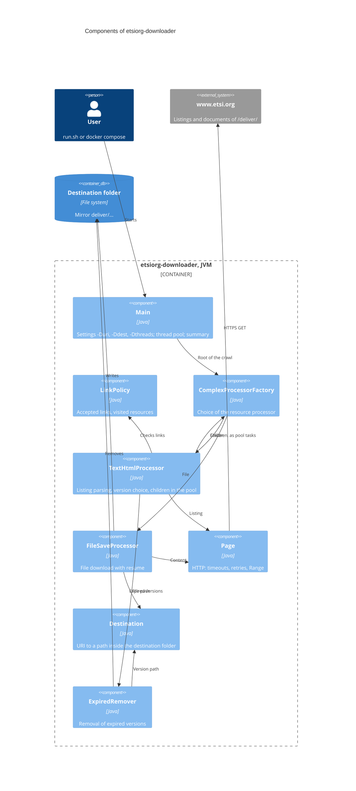

# ADR-0004: Concurrency model — all resource processing in one bounded pool

- Status: Accepted
- Date: 2026-10-30
- Russian version: [ADR-0004](ru/0004-bounded-executor.md)

## Context

`TextHtmlProcessor` started processing child resources with `CompletableFuture.supplyAsync` without an executor (#12),
and the pool from `Main` only merged the results:

- with 2 or fewer available CPUs (a usual container limit) `CompletableFuture` creates a new thread for every task
  (`ThreadPerTaskExecutor`) — a thread and a connection per listing line, thousands of threads, a risk of
  `OutOfMemoryError: unable to create native thread` and of an IP ban by the site;
- with more CPUs blocking I/O ran in `ForkJoinPool.commonPool()` with parallelism CPU−1 that cannot be configured;
- if the asynchronous stage had already completed when `thenApply` was attached, the child resource, a download
  included, was processed synchronously in the parent's thread, `main` included;
- the requests presented themselves as a browser: `User-Agent: Mozilla/5.0`.

## Decision

- The whole processing of a resource — creating the `Page`, choosing the processor, parsing a listing or
  downloading — runs as a task `supplyAsync(..., executor)` of the pool from `Main`; the result is unwrapped with
  `thenCompose(identity())`, and merging the results of the children (`allOf`) creates no separate tasks.
- The pool size is set with the `-Dthreads` property (the number of available processors by default); the executor
  is mandatory for `ComplexProcessorFactory` and `TextHtmlProcessor`.
- Tasks do not wait for each other with blocking calls: a parent returns a future and does not hold a thread while
  its children are processed.
- `User-Agent: etsiorg-downloader (+https://github.com/sftwnd/etsi-org-downloader)`.

## Rationale

- The number of threads and simultaneous connections is limited and predictable on any machine and in a container,
  and it does not depend on the implicit rules `CompletableFuture` uses to choose a pool.
- A separate semaphore for the number of requests is not needed (KISS): every HTTP request runs as a task of the pool,
  so a pool of N threads gives at most N simultaneous requests.
- Without blocking waits inside a fixed-size pool, a deadlock where all the threads wait for tasks that have no thread
  to run in is impossible; composition with `thenCompose` keeps this property.
- An honest User-Agent lets the site administrators see who is accessing the site and get in touch; it has been
  checked that www.etsi.org answers such a request with `200`.

## Consequences

- The pool queue is not bounded: it holds the tasks for the resources found but not processed yet, so memory grows
  with the "front" of the crawl, not with the number of threads.
- By default the parallelism equals the number of CPUs; for a slow link or a gentle mode — `-Dthreads=2`.

## Component diagram (C4, level 3)

