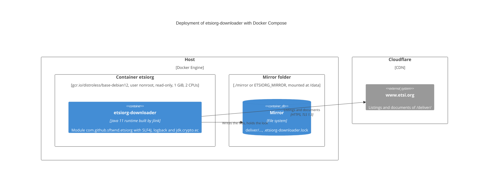

# ADR-0017: The image runs the module in a runtime built by jlink on a distroless system

- Status: Accepted
- Date: 2026-10-30
- Amended: 2026-10-30 — the name of the image, its labels and the version of the downloader (#69)
- Russian version: [ADR-0017](ru/0017-jlink-runtime-image.md)

## Context

The runtime stage of the image was `eclipse-temurin:11-jre`, 295 MB: the whole JRE on Ubuntu with its shell and
package manager, to start the fat jar on the class path (#60). The downloader is a named module
([ADR-0011](0011-jpms-module.md)), and the modules it needs at runtime are named modules as well, so `jlink` can link
them with only the modules of the JDK they require.

Two modules are not found by `jlink` by itself, because they are bound as services, not required: logback, the provider
of SLF4J, and `jdk.crypto.ec`. Without the latter the TLS handshake with www.etsi.org behind Cloudflare fails with
`handshake_failure` (checked). The native libraries of the JDK need glibc only: the JDK of Temurin has its own zlib
and links the C++ library statically (checked with `ldd`). The listings are UTF-8, which `java.base` supports.

## Decision

- The build stage links the runtime with
  `jlink --add-modules com.github.sftwnd.etsiorg,ch.qos.logback.classic,jdk.crypto.ec --strip-debug --no-header-files
  --no-man-pages --compress=2` from the modular jar of the downloader and `target/lib`. The runtime has 7 modules:
  the downloader, `org.slf4j`, `ch.qos.logback.classic`, `ch.qos.logback.core`, `java.base`, `java.xml` and
  `jdk.crypto.ec`.
- The runtime stage is `gcr.io/distroless/base-debian12`: glibc without a shell and a package manager. The image runs
  as its user `nonroot` (UID 65532) and starts the module: `/opt/etsiorg/bin/java … -m com.github.sftwnd.etsiorg`.
- The continuous integration ([ADR-0012](0012-continuous-integration.md)) checks that the runtime of the built image
  has the modules bound as services.
- The image is `sftwnd/etsiorg-downloader` without a version tag, with the OCI labels `title`, `description`,
  `source`, `url`, `licenses` and `base.name`. The version is not a label: the downloader reports it — a run logs
  `etsiorg-downloader <version>, Java <version>` at the start, and `--help` prints it — from the descriptor of its
  module on the module path and from `Implementation-Version` of the manifest of its jar on the class path.

## Rationale

- The image is 61.5 MB instead of about 300: it is pulled faster and holds less code that could need security updates.
- The image has no shell, no package manager and no modules the downloader does not use: there is less to attack in
  a container that processes data from the network.
- The module path checks at the start that every required module is present and the packages are not split, which
  the class path of the fat jar does not.
- distroless is a maintained minimal base with glibc; an image based on musl, like Alpine, would need another build
  of the JDK.
- The version is set in `pom.xml` only: a Dockerfile cannot read it, so a tag or a label with the version would be
  a second copy, like the one removed from `run.sh` (#73). The version of the module is the version of the code that
  actually runs, whatever the image is called.

## Consequences

- A module that is bound as a service has to be named in `--add-modules`; a new `requires` of the downloader is found
  by `jlink` by itself.
- The container has no shell: it is debugged with the logs or with the `:debug` variant of the base image.
- The user of the container is 65532: on Linux the mirror folder is made writable for it,
  e.g. `sudo chown 65532 mirror`.
- The fat jar on the class path remains the way of `run.sh`; the image runs the same module that `ModulePathIT` checks
  on the module path.

## Deployment diagram (C4)

