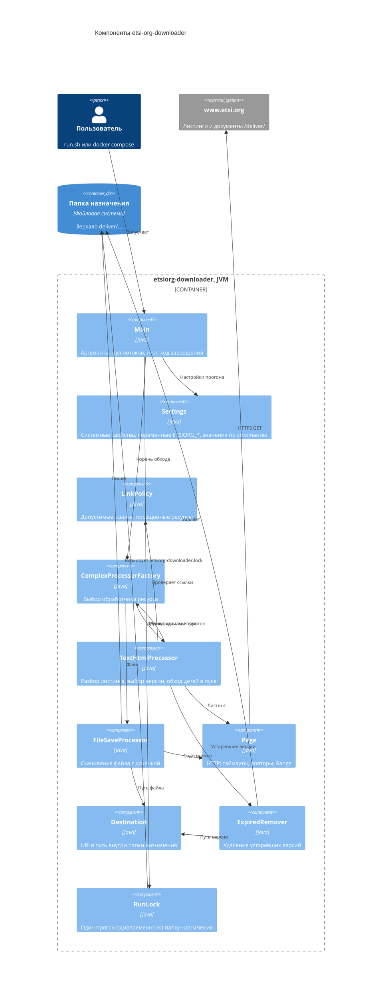

# ADR-0004: Модель конкурентности — вся обработка ресурсов в одном ограниченном пуле

- Статус: Принято
- Дата: 2026-10-30
- Изменено: 2026-10-30 — по умолчанию 4 потока вместо числа процессоров (#57); `Settings` и `RunLock` на диаграмме
  компонентов (#61, #62)
- Версия на английском: [ADR-0004](../0004-bounded-executor.md)

## Контекст

`TextHtmlProcessor` запускал обработку дочерних ресурсов через `CompletableFuture.supplyAsync` без executor (#12),
а пул из `Main` только склеивал результаты:

- при 2 и менее доступных CPU (обычный лимит контейнера) `CompletableFuture` создаёт новый поток на каждую задачу
  (`ThreadPerTaskExecutor`) — поток и соединение на каждую строку листинга, тысячи потоков, риск
  `OutOfMemoryError: unable to create native thread` и блокировки IP со стороны сайта;
- при большем числе CPU блокирующий ввод-вывод шёл в `ForkJoinPool.commonPool()` с параллелизмом CPU−1 без настройки;
- если асинхронный этап уже завершился к моменту подписки `thenApply`, дочерний ресурс, включая скачивание,
  обрабатывался синхронно в потоке родителя, в том числе в `main`;
- запросы представлялись браузером: `User-Agent: Mozilla/5.0`.

## Решение

- Обработка ресурса целиком — создание `Page`, выбор обработчика, разбор листинга или скачивание — выполняется задачей
  `supplyAsync(..., executor)` в пуле из `Main`; результат разворачивается через `thenCompose(identity())`,
  а слияние результатов детей (`allOf`) не создаёт отдельных задач.
- Размер пула задаётся свойством `-Dthreads`, по умолчанию 4; executor обязателен для `ComplexProcessorFactory`
  и `TextHtmlProcessor`.
- Задачи не ждут друг друга блокирующими вызовами: родитель возвращает future и не держит поток, пока обрабатываются дети.
- `User-Agent: etsiorg-downloader (+https://github.com/sftwnd/etsi-org-downloader)`.

## Обоснование

- Число потоков и одновременных соединений ограничено и предсказуемо на любой машине и в контейнере и не зависит
  от неявных правил выбора пула в `CompletableFuture`.
- Отдельный семафор на число запросов не нужен (KISS): каждый HTTP-запрос выполняется задачей пула, поэтому пул
  из N потоков даёт не больше N одновременных запросов.
- Значение по умолчанию выбрано по нагрузке на сайт, а не по машине: число процессоров к ней отношения не имеет,
  а контейнер на машине с 16 процессорами видит все 16, и выходило 16 одновременных запросов к www.etsi.org.
  4 запроса — меньше 6 соединений с одним хостом, которые открывает браузер по HTTP/1.1.
- Без блокирующих ожиданий внутри пула фиксированного размера невозможна взаимная блокировка, когда все потоки ждут
  задачи, которым не хватает потоков; композиция через `thenCompose` сохраняет это свойство.
- Честный User-Agent позволяет администраторам сайта понять, кто обращается, и связаться; проверено,
  что www.etsi.org отвечает на такой запрос `200`.

## Последствия

- Очередь пула не ограничена: в ней лежат задачи для найденных, но ещё не обработанных ресурсов, поэтому память
  растёт с «фронтом» обхода, а не с числом потоков.
- По умолчанию параллелизм равен 4 на любой машине; `-Dthreads` увеличивает его для быстрого канала или уменьшает
  для бережного режима, например `-Dthreads=2`.

## Диаграмма компонентов (C4, уровень 3)

