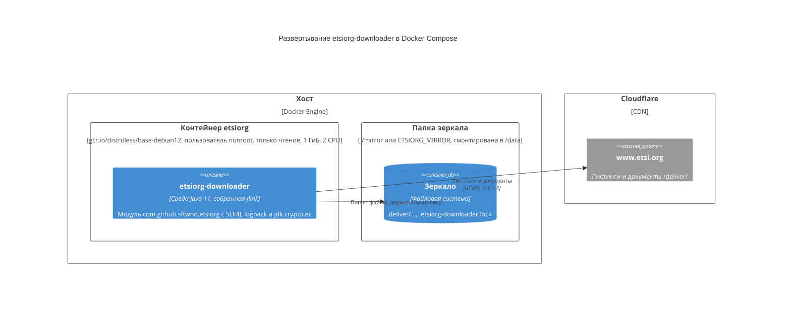

# ADR-0017: Образ запускает модуль в среде, собранной jlink, на системе distroless

- Статус: Принято
- Дата: 2026-10-30
- Версия на английском: [ADR-0017](../0017-jlink-runtime-image.md)

## Контекст

Этап выполнения образа был `eclipse-temurin:11-jre`, 295 МБ: полная JRE на Ubuntu с её оболочкой и менеджером пакетов,
чтобы запускать fat jar на classpath (#60). Загрузчик — именованный модуль ([ADR-0011](0011-jpms-module.md)), и модули,
нужные ему во время выполнения, тоже именованные, поэтому `jlink` может связать их только с теми модулями JDK, которые
им требуются.

Два модуля `jlink` сам не находит, потому что они подключаются как сервисы, а не через `requires`: logback, провайдер
SLF4J, и `jdk.crypto.ec`. Без последнего TLS-рукопожатие с www.etsi.org за Cloudflare завершается `handshake_failure`
(проверено). Нативным библиотекам JDK нужна только glibc: JDK от Temurin содержит свою zlib и статически связывает
библиотеку C++ (проверено через `ldd`). Листинги — в UTF-8, которую поддерживает `java.base`.

## Решение

- Этап сборки связывает среду выполнения командой
  `jlink --add-modules com.github.sftwnd.etsiorg,ch.qos.logback.classic,jdk.crypto.ec --strip-debug --no-header-files
  --no-man-pages --compress=2` из модульного jar загрузчика и `target/lib`. В среде 7 модулей: загрузчик, `org.slf4j`,
  `ch.qos.logback.classic`, `ch.qos.logback.core`, `java.base`, `java.xml` и `jdk.crypto.ec`.
- Этап выполнения — `gcr.io/distroless/base-debian12`: glibc без оболочки и менеджера пакетов. Образ работает от своего
  пользователя `nonroot` (UID 65532) и запускает модуль: `/opt/etsiorg/bin/java … -m com.github.sftwnd.etsiorg`.
- Непрерывная интеграция ([ADR-0012](0012-continuous-integration.md)) проверяет, что в среде собранного образа есть
  модули, подключаемые как сервисы.

## Обоснование

- Образ весит 61,5 МБ вместо примерно 300: он быстрее скачивается и содержит меньше кода, которому могут понадобиться
  обновления безопасности.
- В образе нет оболочки, менеджера пакетов и модулей, которые загрузчик не использует: в контейнере, обрабатывающем
  данные из сети, меньше того, что можно атаковать.
- Module path при запуске проверяет, что все требуемые модули на месте и пакеты не разделены, чего classpath fat jar
  не делает.
- distroless — поддерживаемая минимальная основа с glibc; образу на musl, как Alpine, понадобилась бы другая сборка JDK.

## Последствия

- Модуль, подключаемый как сервис, нужно назвать в `--add-modules`; новый `requires` загрузчика `jlink` найдёт сам.
- В контейнере нет оболочки: его отлаживают по журналу или с вариантом `:debug` базового образа.
- Пользователь контейнера — 65532: на Linux папку зеркала делают доступной ему на запись,
  например `sudo chown 65532 mirror`.
- Fat jar на classpath остаётся способом запуска `run.sh`; образ запускает тот же модуль, который `ModulePathIT`
  проверяет на module path.

## Диаграмма развёртывания (C4)

